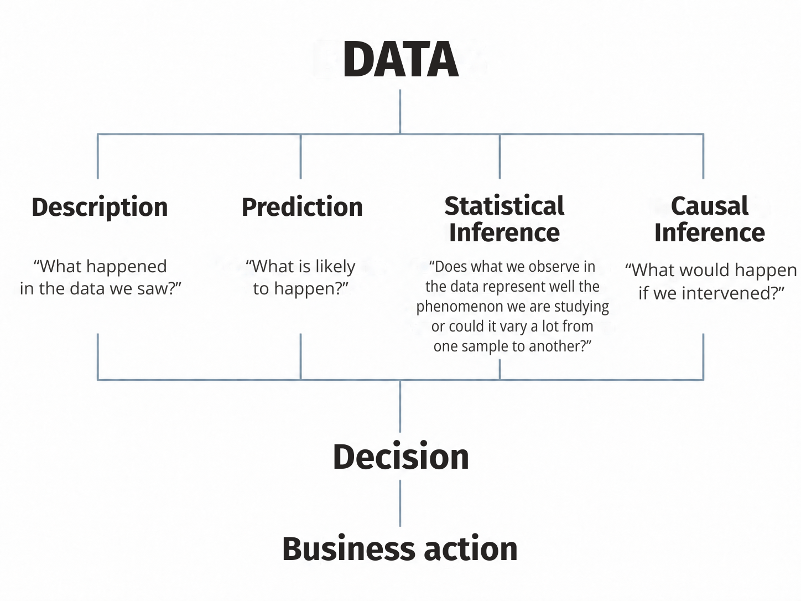

## Before choosing a model

When we think about Data Science, it is common to start with the most famous *Machine Learning* models:

- regression;
- random forest;
- XGBoost;
- neural networks;
- etc.

But that **should not** be the first question.

Before asking:

> *Which model should we use?*

we need to ask:

> **What do we want to learn from the data?**

The answer depends on the kind of question we want to answer and on the decision that will be made based on it.

{.course-figure width="70%"}

Imagine a company concerned about **churn**. It can ask four different questions:

1. **Description:** What was the churn rate last quarter?
2. **Prediction:** Which customers are likely to churn?
3. **Statistical Inference:** Does the observed rate represent the churn level of our customers well, or could it vary substantially from one sample to another?
4. **Causal Inference:** If we offer a benefit, by how much will churn decrease because of that intervention?

All four questions use data. Some may even use the same models. But they are different problems.

> **The question comes before the model.**

## 1. Description: what happened in the data we observed?

### The question

Sometimes we simply want to summarize what we have already observed.

For example:

- What was the churn rate last quarter?
- How many users converted in this campaign?
- What was the average revenue per customer?
- Which segment had the highest conversion?
- How many orders were delivered late?

If we had 10,000 customers in the quarter and 1,000 churned, then the observed churn rate was **10%**.

That number describes those data. We do not need Statistical Inference to say that.

The important point is to distinguish between:

> **describing what happened in the observed data**

and

> **using those data to learn something that goes beyond them.**

That second question is precisely where **Statistical Inference** begins.

### Why does a company want to describe the data?

Because before predicting, inferring, or estimating causal effects, we need to understand what happened.

Description appears in virtually all data work:

- dashboards;
- KPIs;
- reports;
- product monitoring;
- revenue tracking;
- funnel analysis;
- comparisons across periods and segments.

::: {.callout-note}
## Main idea

**Description** answers what happened in the data we observed. By itself, it does not require generalizing to a population, predicting new observations, or interpreting relationships as causal.
:::

## 2. Prediction: what is likely to happen?

### The question

In predictive problems, we want to anticipate an outcome that is still unknown.

For example:

- Will this customer churn?
- Is this transaction fraud?
- Is this user likely to buy?
- How much will we sell next month?
- How long will this delivery take?
- Which lead is likely to convert?
- Which product should we recommend to this user?

The goal is to learn, from the observed data, a function $f$ capable of transforming the available information ($X$) into a good prediction of $Y$ for new cases.

A **general** way to represent this relationship is:

$$
Y = f(X) + \epsilon
$$

When the goal is **prediction**, the main thing is that the learned function should produce good predictions and **generalize to new data**.

That is:

> when new observations of $X$ arrive, will we be able to predict their corresponding values of $Y$ well through the learned rule $f$?

### Why does a company want to predict something?

Because anticipating an event allows it to act before the event occurs.

- predict churn → prioritize customers for retention;
- predict fraud → block or review transactions;
- predict demand → organize inventory and operations;
- predict conversion → prioritize leads;
- predict interest → personalize recommendations.

Prediction usually takes us into the domain of **Statistical Learning and Machine Learning**.

Among its main foundations are:

- **Probability Theory**;
- linear algebra;
- calculus and optimization;
- loss functions;
- train, validation, and test;
- generalization;
- overfitting and regularization;
- cross-validation;
- performance metrics;
- Machine Learning algorithms.

In a purely predictive problem, the main goal is not to estimate a population quantity and quantify its uncertainty, but to build a function that **generalizes well to new data**.

For this reason, Statistical Inference is **in general** not a prerequisite for building a good predictive model.

But it may appear later, when we change the question. It can also appear **within a predictive problem**, as a necessary layer in evaluating what was done.

Suppose two churn models have AUCs of 0.81 and 0.83 on the same test sample.

If we ask:

> **Which model had better observed performance?**

we are simply comparing observed results.

But if we ask:

> **Is this difference of 0.02 likely to persist for new cases, or could it simply be the result of the sample we used?**

we enter a problem of **Statistical Inference**.

Further below, you will understand that this question contains **something very important implicitly**:

- To know what happens in new cases, it would be useful to know more about the "_Process of Nature that Generated the Data_."

However, since it is usually not possible to have that knowledge in the real world, we use a sample to infer something about that **Data-Generating Process**.

::: {.callout-note}
## Main idea

**Prediction** creates value when correctly anticipating an event allows the company to act better before it occurs.
:::

## 3. Statistical Inference: what can we learn beyond the observed data?

### The question

Now the question changes.

We no longer want only to describe the data we have already seen, nor necessarily to predict the outcome of a new individual observation.

We want to use the observed data to **learn some unknown quantity about a population or about the process that generates the data**.

*Why is this necessary?*

Imagine someone asks:

> **What is the true churn rate of our customers?**

That quantity belongs to the **data-generating process** — the *data-generating process* (DGP).

If we knew that process completely, we would know exactly with what probabilities different outcomes are generated, and we could calculate directly the churn rate we care about.

We would not need to estimate it from the observed data.

In practice, however, **we do not know the DGP**.

What we observe is only **one realization of that process**: a sample of customers, transactions, users, or events.

It is from that sample that we try to learn some unknown characteristic of the larger process that generated the data.

That is exactly where **Statistical Inference** comes in:

> use the observed data to learn about an unknown quantity of the population or of the data-generating process, and quantify the uncertainty of that conclusion.

For example:

- Does the observed churn rate represent the churn level of our customers well?
- Is the average conversion observed in this period a good approximation of what we should expect more generally?
- Does the difference in conversion between two groups seem real, or could it simply be data variation?
- Did churn really increase, or are we observing a fluctuation compatible with the variability of the process?

Here is the essential distinction:

> **If we only calculate a metric on the observed data, we are describing those data.**

Statistical Inference begins when we want to use that metric to say something **beyond the observed sample**.

### An example with churn

Suppose we had 10,000 customers this quarter and 1,000 churned.

The observed rate was:

> **10%**

If the question is:

> What was the churn rate of those 10,000 customers?

then the problem is over: **10%**. That is Descriptive Statistics.

But the company may want to use that number for planning, targets, or future decisions.

The question then becomes something like:

> **Does this churn of 10% represent well the churn level we should expect from our customers more generally?**

Now uncertainty exists.

Another sample of customers, another period, or another realization of the same process could produce 9%, 11%, 13%, or some other value.

The observed 10% then starts being used as an **estimate** of a quantity we do not observe directly: the underlying churn level of the population or of the process that generates these customers.

This is when concepts such as:

- estimator;
- sampling distribution;
- standard error;
- confidence interval;
- hypothesis tests.

come in.

An intuitive way to think about this is:

> the customers who have already churned belong to the past. To know what happened to them, we just need to look at the data. Statistical Inference appears when we use those customers to learn something we want to transport beyond them — including to customers and periods we have not yet observed.

### Why does a company want to do inference?

Because metrics vary, but **not every observed variation means the business truly changed**.

Conversion changes from one week to another. Churn changes from one month to another. Average revenue changes across samples. Segments show different results.

Part of this variation may simply be a consequence of the **uncertainty inherent in the data-generating process**. Even if nothing relevant changed in the business, different samples produced by the same process will not be exactly identical.

Consider a simple example: *rolling a die and observing the result*. If we completely knew the **data-generating process**, we would know the probability of each outcome. Even so, we would not know in advance which number will appear on a particular roll.

This is the **uncertainty inherent in the process**: even knowing its probabilities perfectly, different realizations can produce different results. We might observe 1, then 3, then 1 again, without anything having changed in the die or in the process that generates it.

But knowing those probabilities would give us something fundamental: we would know **what variation is normal and expected for that process**, and we could make decisions based on that structure.

In companies (_or in the real world more generally_), the problem is that we usually **do not know the generating process nor its probabilities**. We only have the data it produced, and we try to learn about the process from them using **statistical inference**.

So observing that conversion dropped from 10% to 9.7% is not enough to conclude that a real change occurred. Perhaps something changed. But perhaps the same process, working exactly as before, could naturally produce 10% in one sample and 9.7% in another.

An important function of **Statistical Inference** is precisely to quantify this uncertainty and help separate:

> **_a difference that suggests a change in the data-generating process_**

from

> **_a difference still compatible with the variability that the process itself can generate_.**

If we treat every observed variation **as a real business change** (that is, as something inherent to the business data-generating process), we may react to **noise**.

This distinction helps avoid hasty decisions and better understand what the data really allow us to conclude.

### What do we need to learn in order to do Statistical Inference?

**Probability Theory** provides the mathematical language to represent uncertainty and reason about what could happen if we repeated the process of generating and sampling the data.

Then come concepts such as:

- sampling;
- statistics and estimators;
- sampling distributions;
- Law of Large Numbers;
- Central Limit Theorem;
- standard error;
- estimation;
- properties of estimators;
- confidence intervals;
- hypothesis tests;
- p-values;
- Type I and Type II errors.

This construction makes it possible to transform:

> "we observed this number"

into something like:

> "based on the data and on the assumptions of our model, this is our best estimate of the quantity of interest, and this is the uncertainty associated with it."

::: {.callout-note}
## Main idea

**Description** says what happened in the data we observed. **Statistical Inference** uses the data we observed to learn about what we do not fully observe, quantifying the uncertainty of that step.
:::

## 4. Causal Inference: what would happen if we did something?

### The question

Now the question changes again.

Companies do not want only to observe or predict the world. They want to **act on it**.

They:

- change prices;
- launch features;
- send campaigns;
- offer discounts;
- change interfaces;
- change processes;
- create policies;
- modify algorithms.

And then a different question arises:

> What changed **because of** our action?

Examples:

- If we offer a coupon, by how much do purchases increase?
- If we change the checkout screen, by how much does conversion increase?
- If we raise the price, how does demand change?
- Did this campaign increase revenue?
- Did this new onboarding reduce churn?

The fundamental expression here is:

> **because of.**

We do not want to know simply whether two things appear together, but whether changing one of them **causes** a change in the other.

### The Jump of the Cat: Association is not intervention

Imagine that customers who receive coupons buy more.

This does not necessarily mean that:

> coupons caused those customers to buy more.

Perhaps the company offers coupons precisely to its best customers, who would already buy more even without the coupon.

Likewise:

> users who use a certain feature have higher retention.

This does not necessarily mean that:

> making a user use that feature will increase their retention.

Perhaps naturally more engaged users are precisely the ones who use the feature.

**Causal Inference** tries to answer:

> What would have happened to those same units if the intervention had been different?

This is the idea of the **counterfactual**.

### Prediction is not Causal Inference

Imagine two customers.

Customer A:

- 90% predicted probability of churn;
- practically no response to a retention intervention.

Customer B:

- 40% predicted probability of churn;
- their probability could fall to 10% if they received the intervention.

If the company looks only at prediction, it will probably prioritize A.

But if the question is:

> "For whom will this intervention have the greatest impact?"

B may be the more interesting customer.

Therefore:

> **high predicted risk does not mean high causal effect.**

### What do we need to learn in order to do Causal Inference?

Causal Inference does not replace Statistical Inference. It builds on it and adds a new layer.

Besides the foundations of Probability and Statistical Inference, concepts such as these come in:

- treatment;
- outcome;
- potential outcomes;
- counterfactual;
- treatment effect;
- randomization;
- confounding;
- identification;
- selection bias;
- experiments and A/B tests;
- observational data;
- Difference-in-Differences;
- Instrumental Variables;
- Regression Discontinuity;
- matching and weighting;
- heterogeneous treatment effects;
- Causal Machine Learning.

There is one particularly important distinction:

**Statistical Inference** helps answer:

> "How precisely did we estimate this quantity?"

**Causal Inference** must first answer:

> "Can this quantity be interpreted as a causal effect?"

Only after that do we estimate this effect and quantify its uncertainty.

::: {.callout-important}
## Identification comes before estimation

An extremely precise confidence interval around the wrong quantity still does not answer the causal question.

Causal Inference requires not only estimating well, but also justifying why the estimated quantity represents the effect of the intervention we want to know.
:::

::: {.callout-note}
## Main idea

**Causal Inference** creates value when we need to discover which actions truly cause changes in the outcomes that matter to the company.
:::

## The same churn problem, four different questions

Now we can return to the same example and clearly separate the four types of question:

| Company question | What do we want to learn? | Type of problem |
|---|---|---|
| **"What was our churn last quarter?"** | What happened to the observed customers. | **Description** |
| **"Which customers are likely to churn?"** | The likely outcome for new cases. | **Prediction** |
| **"We observed 10% churn. Does this number represent the churn level of our customers well, or could it vary substantially?"** | A quantity that goes beyond the observed sample, and the uncertainty associated with it. | **Statistical Inference** |
| **"If we offer a benefit, will churn decrease? By how much?"** | The effect of an intervention. | **Causal Inference** |

The difference can be summarized like this:

> **Description:** what happened?
>
> **Prediction:** what is likely to happen?
>
> **Statistical Inference:** what can we learn beyond the data we observed, and with what uncertainty?
>
> **Causal Inference:** what would happen if we changed something?

## A mental map

When you face a new Data Science problem, start with these questions:

### Do I only want to summarize what happened?

> What happened in the data we observed?

**Description**

---

### Do I want to anticipate an outcome?

> What is likely to happen?

**Prediction**

---

### Do I want to learn something beyond the observed data and quantify uncertainty?

> What do the data allow me to conclude beyond the sample?

**Statistical Inference**

---

### Do I want to know the effect of changing something?

> What would happen if I intervened?

**Causal Inference**

---

And only afterwards ask:

> Which method or model should I use?

## The model does not define the question

It is important not to automatically associate certain algorithms with certain paradigms.

For example:

> regression = Statistical Inference

or

> XGBoost = Prediction.

A regression can be used for **Prediction**, **Statistical Inference**, or within a **causal analysis**.

Machine Learning can also be used within Causal Inference.

Therefore:

> **the algorithm does not define the problem. The question defines the problem.**

The model is a tool chosen only after we know what we want to learn.

## And where does Bayesian Statistics fit in?

Bayesian Statistics is not a fifth category parallel to the four above.

It offers another way to represent and update uncertainty from data.

Bayesian methods can be used in:

- Prediction;
- Statistical Inference;
- Causal Inference;
- decision making.

For now, it is enough to keep in mind that:

> "Bayesian" and "Frequentist" refer to frameworks of inference, and do not replace the distinction between describing, predicting, inferring, and estimating causal effects.

We will return to these ideas later. However, we will not cover Bayesian Statistics in this course.

## Does company size or business model matter?

Not necessarily.

Large digital companies often have particularly favorable conditions:

- many users;
- many interactions;
- many repeated decisions;
- good instrumentation;
- experimentation infrastructure.

That is why we see companies such as iFood, Nubank, Amazon, Uber, Booking, and Netflix making intensive use of Machine Learning, Experimentation, and Causal Inference.

But company size, or whether it is B2B or B2C, does not by itself determine which questions can be asked.

A small company may have millions of observations, while a huge company may have little information for a specific question.

It is also important to remember:

> **number of rows is not necessarily the effective sample size.**

A dataset may contain 20 million events produced by only a few hundred companies.

If the intervention occurs at the company level, the relevant number of units may be much smaller than 20 million.

What matters is the combination of:

- business question;
- unit of analysis;
- unit of intervention;
- amount of independent information;
- data quality;
- ability to measure outcomes;
- economic value of the answer.

## Where does this course fit in?

This course **is not a predictive Machine Learning course**.

Our path will be aimed mainly at:

> **Statistical Inference and Causal Inference.**

To get there, we will build the necessary foundations:

**Mathematics**

↓

**Probability Theory**

↓

**Statistical Inference**

↓

**Regression**

↓

**Causal Inference**

We will begin with Mathematics and Probability Theory, because we need a rigorous language to represent uncertainty.

Then we will study Statistical Inference, learning how observed data can be used to learn about quantities that go beyond the sample, and how to quantify the uncertainty of those conclusions.

We will study Regression, one of the most important tools for modeling relationships between variables and a fundamental bridge to Causal Inference.

Finally, we will arrive at Causal Inference, where we will add a new question:

> What would happen if we intervened in the world?

## What to remember

Before choosing any model, ask:

> **What do we want to learn from the data?**

**Description**

What happened in the data we observed?

→ Helps the company **understand and measure what happened**.

**Prediction**

What is likely to happen?

→ Helps the company **anticipate**.

**Statistical Inference**

What can we learn beyond the observed data, and with what uncertainty?

→ Helps the company **generalize without treating an observed metric as the exact truth about the whole**.

**Causal Inference**

What would happen if we did something?

→ Helps the company **discover which actions truly change outcomes**.

Models come afterwards. **The question comes first**.
