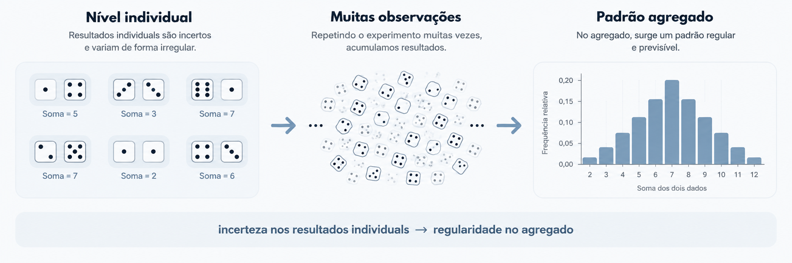

<!--
MAIN SOURCES

Spanos:
- Chapter 1 — An Introduction to Empirical Modeling
- 1.2 Stochastic Phenomena
- 1.3 Chance Regularity and Statistical Models

Bertsekas & Tsitsiklis:
- Chapter 1 — Sample Space and Probability
-->

In the prelude, we saw the overall map: real-world phenomena produce data, and we use Probability to construct a mathematical representation of the mechanism capable of generating them.

But before calculating probabilities, we need to answer:

> **Why do we need a Theory of Probability?**

The answer begins with the type of phenomenon we want to represent.

## Deterministic vs. stochastic

Consider $y=f(x)=2x+1$.

If $x=3$, then necessarily $y=7$.

Given $x$ and the mechanism $f$, the result is determined.

This is a **deterministic phenomenon**.

Now think of a **user's checkout session on an e-commerce platform**.

We may know the device, country, time, products in the cart, and several other characteristics of the user.

Even so, **we do not necessarily know** whether the user will make a purchase.

The outcome may be:

$$
\text{purchase}
\qquad\text{or}\qquad
\text{no purchase}.
$$

There is **uncertainty about the outcome that will be observed**.

This is the type of situation we will call a **stochastic phenomenon**.

> In a stochastic phenomenon, we cannot determine in advance which particular outcome will be observed.

But this does not mean an absence of structure.

## Chance and regularity

Spanos[^1] uses the expression *chance regularity* to describe a fundamental characteristic of stochastic phenomena:

[^1]: Spanos, A. (1999). *Probability Theory and Statistical Inference: Econometric Modeling with Observational Data*. Cambridge University Press.

$$
\underbrace{\text{Chance}}_{\text{individual uncertainty}}
+
\underbrace{\text{Regularity}}_{\text{aggregate structure}}.
$$

In words:

> **uncertainty in the individual outcome, regularity when we observe many outcomes.**

Consider rolling two dice.

On a single roll, the sum can be any value between $2$ and $12$, and we do not know in advance which will be observed.

But the possible values do not have the same structure:

::: {.compact-table}

| Sum | Possible combinations |
|:---:|:---:|
| 2 | 1 |
| 3 | 2 |
| 4 | 3 |
| 5 | 4 |
| 6 | 5 |
| 7 | 6 |
| 8 | 5 |
| 9 | 4 |
| 10 | 3 |
| 11 | 2 |
| 12 | 1 |

:::

The sum $7$, for example, can occur in six ways:

$$
(1,6),(2,5),(3,4),(4,3),(5,2),(6,1),
$$

whereas the sum $2$ can only occur as

$$
(1,1).
$$

We can visualize this structure:

```{=html}
<div style="width: 100%; max-width: 900px; margin: 2rem auto; overflow-x: auto;">

<svg xmlns="http://www.w3.org/2000/svg"
     viewBox="0 0 900 390"
     width="100%"
     style="display: block;"
     role="img"
     aria-label="Number of possible combinations for each sum of two dice">

  <line x1="70" y1="310" x2="850" y2="310"
        stroke="currentColor" stroke-width="2"/>

  <rect x="90"  y="270" width="45" height="40"  fill="currentColor" opacity="0.70"/>
  <rect x="155" y="230" width="45" height="80"  fill="currentColor" opacity="0.70"/>
  <rect x="220" y="190" width="45" height="120" fill="currentColor" opacity="0.70"/>
  <rect x="285" y="150" width="45" height="160" fill="currentColor" opacity="0.70"/>
  <rect x="350" y="110" width="45" height="200" fill="currentColor" opacity="0.70"/>
  <rect x="415" y="70"  width="45" height="240" fill="currentColor" opacity="0.70"/>
  <rect x="480" y="110" width="45" height="200" fill="currentColor" opacity="0.70"/>
  <rect x="545" y="150" width="45" height="160" fill="currentColor" opacity="0.70"/>
  <rect x="610" y="190" width="45" height="120" fill="currentColor" opacity="0.70"/>
  <rect x="675" y="230" width="45" height="80"  fill="currentColor" opacity="0.70"/>
  <rect x="740" y="270" width="45" height="40"  fill="currentColor" opacity="0.70"/>

  <g fill="currentColor" font-size="16" text-anchor="middle">
    <text x="112" y="260">1</text>
    <text x="177" y="220">2</text>
    <text x="242" y="180">3</text>
    <text x="307" y="140">4</text>
    <text x="372" y="100">5</text>
    <text x="437" y="60">6</text>
    <text x="502" y="100">5</text>
    <text x="567" y="140">4</text>
    <text x="632" y="180">3</text>
    <text x="697" y="220">2</text>
    <text x="762" y="260">1</text>
  </g>

  <g fill="currentColor" font-size="16" text-anchor="middle">
    <text x="112" y="335">2</text>
    <text x="177" y="335">3</text>
    <text x="242" y="335">4</text>
    <text x="307" y="335">5</text>
    <text x="372" y="335">6</text>
    <text x="437" y="335">7</text>
    <text x="502" y="335">8</text>
    <text x="567" y="335">9</text>
    <text x="632" y="335">10</text>
    <text x="697" y="335">11</text>
    <text x="762" y="335">12</text>
  </g>

  <text x="437" y="375"
        text-anchor="middle"
        font-size="18"
        fill="currentColor">
    Sum of the two dice
  </text>

</svg>

</div>
```

We have not defined any probabilities yet.

But we have already recognized the important idea:

> **uncertainty can have structure.**

## Repetition and frequency

Now imagine rolling the two dice many times:

$$
7,\;4,\;10,\;6,\;7,\;9,\;3,\;8,\ldots
$$

Each individual outcome remains uncertain, but we can observe how many times a particular event occurs.

If the sum $7$ appears $18$ times in $100$ rolls, its **observed relative frequency** will be

$$
\frac{18}{100}=0.18.
$$

If we repeat the process, we may obtain $0.15$, $0.19$, $0.17,\ldots$

These frequencies vary, but they may exhibit **regularity** as the number of observations increases.

This is precisely the combination:

$$
\boxed{
\text{individual uncertainty}
+
\text{aggregate regularity}
}
$$

::: {.callout-note title="Probability is not relative frequency"}

**Relative frequency** is something we observe in the data.

**Probability** will be part of the mathematical model we construct.

Later, the [**Law of Large Numbers**]{.concept} (_LLN_) will establish the relationship between these two ideas under certain conditions.

:::

{.course-figure width="80%"}

## From the phenomenon to the data

In the real world, we generally do not observe the stochastic mechanism directly; we observe its **realizations**.

In a checkout session, for example, we may observe:

::: {.compact-table}

| user_id | purchase |
|:---:|:---:|
| 1 | 0 |
| 2 | 0 |
| 3 | 1 |
| 4 | 0 |
| 5 | 0 |

:::

This forces us to distinguish between two things:

$$
\boxed{
\text{mechanism that generates the data}
\neq
\text{observed data}
}
$$

The data are what we observe. The **underlying mechanism** is what we want to represent mathematically.

Later, we will call this mechanism the [**Data-Generating Process**]{.concept}, or **DGP**.

## Why Probability?

We thus arrive at our initial question:

> **how can we mathematically represent a phenomenon whose individual outcome is uncertain, but which has structure and may exhibit regularity?**

This is what we will construct **Probability Theory** for.

It **will not eliminate uncertainty** or necessarily tell us which outcome will occur. It will provide a language for stating precisely:

- which outcomes are possible;
- which sets of outcomes we want to study;
- how we assign probabilities to them.

For now, just remember the story:

$$
\boxed{
\text{stochastic phenomenon}
\longrightarrow
\text{uncertainty + regularity}
\longrightarrow
\text{probability model}
}
$$

## Before moving on

So far, we have established the motivation: stochastic phenomena combine **uncertainty in the individual outcome** with some kind of **structure or regularity**.

The next step is to turn this intuition into mathematics.

In the next chapter, we will begin the formalization: we will see how to define precisely the phenomenon we want to study and how to organize the mathematical objects that will allow us to move from Probability to Statistics.

> **The question is no longer simply “why Probability?” It becomes: how do we construct a mathematical model to represent this uncertainty?**
