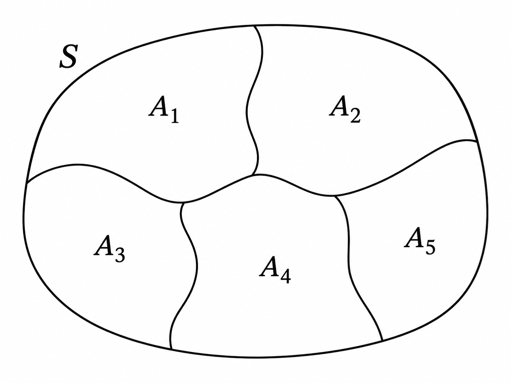

<!--

MAIN SOURCES FOR THIS SECTION

Spanos:
- Chapter 2 — Probability Theory: A Modeling Framework
- 2.4 Random Experiments
- 2.5 Formalizing Condition [a]: The Outcomes Set
- 2.6 Formalizing Condition [b]: Events and Probabilities

Bertsekas & Tsitsiklis:
- Chapter 1 — Sample Space and Probability
- 1.1 Sets
- 1.2 Probabilistic Models

Robert Ash:
- Chapter 1 — Basic Concepts
- Sample space, events and probability measure

CENTRAL IDEA OF THIS QMD

Answer a single question:

How do we go from an uncertain experiment to constructing
a mathematical probability space (Omega, F, P)?

-->

In the previous chapter, we started with a [**Random Experiment**]{.conceito} and began constructing its mathematical representation.

The overall architecture is:

$$
\boxed{\text{Random Experiment}}
\longrightarrow
\boxed{\text{mathematical representation}}
\longrightarrow
\boxed{\text{Statistical Space}}
$$

The [**Statistical Space**]{.conceito} organizes this formalization into two parts:

```{=html}
<div style="max-width: 900px; margin: 2rem auto; border: 2px solid currentColor; border-radius: 12px; padding: 1.25rem 1.5rem 1.5rem 1.5rem;">
  <div style="text-align: center; font-weight: 700; font-size: 1.15rem; margin-bottom: 1rem;">
    Statistical Space
  </div>
  <div style="display: flex; gap: 1rem; flex-wrap: wrap;">
    <div style="flex: 1 1 280px; border: 1.5px solid currentColor; border-radius: 9px; padding: 1rem; text-align: center;">
      <strong>Probability Space</strong><br>
      <span style="font-size: 0.95rem;">formalizes what can happen and how we represent its uncertainty</span><br><br>
      <span>\((\Omega,\mathcal F,P)\)</span>
    </div>
    <div style="flex: 1 1 280px; border: 1.5px solid currentColor; border-radius: 9px; padding: 1rem; text-align: center;">
      <strong>Sampling Space</strong><br>
      <span style="font-size: 0.95rem;">formalizes the repetition of the experiment</span><br><br>
        <span>\(\mathcal G_n=\{T_1,T_2,\ldots,T_n\}\)</span><br><br>
        <span>(we will see this later)</span>
    </div>
  </div>
</div>
```

In this chapter, we will **open only the first box**.

We continue formalizing the same [**Random Experiment**]{.conceito}, but now we will examine in detail the structure responsible for conditions [a] and [b]:

- which outcomes are possible;
- how to mathematically represent the uncertainty about which one will occur.

This structure is the [**Probability Space**]{.conceito}:

$$
\boxed{(\Omega,\mathcal F,P)}
$$

We will construct it by answering three questions:

::: {.callout-note title="The three questions"}

1. **What can happen?** $\rightarrow \Omega$

2. **Which events do we want to ask questions about?** $\rightarrow \mathcal F$

3. **How do we assign probabilities to these events?** $\rightarrow P$

:::

For now, we will remain entirely within this first box. The formalization of repeated trials of the experiment will come in the next step.

## 1. What can happen in a trial of an experiment? ($\Omega$)

We begin by defining the experiment.

An [**experiment**]{.conceito} is the procedure whose outcome we want to model.

When we carry out this procedure once, we perform a [**trial**]{.conceito}.

At the end of a trial, something has happened.

The complete outcome of that trial, called an [**elementary outcome**]{.conceito}, is denoted by $\omega$, while the set of all possible outcomes is denoted by $\Omega$.

For example, if the experiment is

> rolling a die once,

one possible elementary outcome is $\omega=4$.

Thus, the set $\Omega$ of **all possible elementary outcomes** is called the [**sample space**]{.conceito}:

$$
\boxed{
\Omega=\{\text{all possible elementary outcomes of the experiment}\}
}
$$

Therefore, an element of this set is represented by

$$
\boxed{
\omega\in\Omega
}
$$

In other words:

- $\omega$ represents **one specific possibility**;
- $\Omega$ represents **the set of all possibilities**.

When rolling a die,

$$
\Omega=\{1,2,3,4,5,6\},
$$

and, after one trial, we might observe, for example,

$$
\omega=4.
$$

### The form of $\Omega$ depends on how we define the experiment

The sample space must represent everything we want to observe **at the end of a trial**.

If the experiment produces only one piece of information, an elementary outcome $\omega$ may have a single coordinate.

For example:

> tossing a coin once.

In this case, $\Omega=\{H,T\}$ and one possible outcome is $\omega=H$.

Now suppose the experiment is:

> tossing a coin twice and recording the order.

A trial now ends only after both tosses.

Therefore, each elementary outcome must record two pieces of information: $\Omega=\{(H,H),(H,T),(T,H),(T,T)\}$

For example, $\omega=(H,T)$.

This is still **a single elementary outcome of a single trial**.

The same applies if the experiment is:

> rolling two dice and recording the result of each die separately.

If $\Omega_1=\Omega_2=\{1,2,3,4,5,6\}$, then $\Omega=\Omega_1\times\Omega_2$.

The [**Cartesian product**]{.conceito} simply allows us to construct a space whose outcomes have multiple coordinates.

For example, $\omega=(2,5)$ means that the first die showed $2$ and the second showed $5$. The same principle appears in real-world problems.

Imagine a user reaching the checkout page.

If we only want to record

> was a purchase made?

we can use $\Omega=\{\text{purchase},\text{no purchase}\}$.

But if we also want to record the payment method, the outcome must retain more information.

Suppose, for example, that there are two possible payment methods: card or Pix.

In this case, we could define

$$
\Omega=
\{
(\text{purchase},\text{card}),
(\text{purchase},\text{Pix}),
(\text{no purchase},\text{no payment})
\}.
$$

One possible elementary outcome would be $\omega=(\text{purchase},\text{card})$.

Now each $\omega$ preserves two pieces of information about the trial: **whether a purchase was made** and, if so, **which payment method was used**.

::: {.callout-important title="The central idea"}

The number of coordinates of $\omega$ depends on **how we define a trial of the experiment** and **which information we want to preserve in the outcome**.

Having multiple coordinates does not, in itself, mean that we are dealing with a statistical sample.

Later, when we repeat an experiment $n$ times to construct a sample, we will use a similar idea — a product space — but this time each coordinate will represent **a different trial**.

:::

### Two important properties of outcomes

For the elementary outcomes in $\Omega$ to describe the experiment completely and unambiguously, we want two properties:

- **collectively exhaustive**: in a trial of the experiment, **some outcome in $\Omega$ must occur**;
- **mutually exclusive**: if one elementary outcome occurs, **no other elementary outcome can occur at the same time**.

Together, these two ideas say something quite simple:

> **at the end of a trial, we must be able to point to exactly one $\omega\in\Omega$, that is, one possible outcome, and say: “this is what happened.”**

Since $\Omega$ is already defined as the set of **all possible outcomes**, the idea of exhaustiveness is largely built into the definition itself.

The more interesting point to consider is exclusivity: elementary outcomes must be defined **without overlap**.

Imagine, for example, that we want to model the behavior of a user in an app.

Starting from scratch, we might write:

$$
\Omega=
\{
\text{engaged user},
\text{purchasing user}
\}.
$$

At first glance, this seems reasonable.

But there is a problem: the same user may have **engaged and made a purchase**.

In this case, at the end of the trial, we cannot point to a single $\omega\in\Omega$.

Both outcomes could have occurred at the same time.

Therefore, they do not work well as **elementary outcomes**.

One way to correct this would be to define non-overlapping possibilities:

$$
\Omega=
\{
\text{did not engage and did not purchase},
\text{engaged and did not purchase},
\text{did not engage and purchased},
\text{engaged and purchased}
\}.
$$

Now, at the end of a trial, exactly one of these outcomes occurs.

For example,

$$
\omega=
\text{engaged and purchased}.
$$

This also sets up an important distinction for the next section.

Statements such as

- “the user engaged”;
- “the user made a purchase”;

can both be true at the same time.

They are therefore better represented as **events**, that is, sets of elementary outcomes, rather than as elementary outcomes themselves.

When rolling a die,

$$
\Omega=\{1,2,3,4,5,6\},
$$

both properties arise naturally:

- the six outcomes cover all possibilities;
- at the end of the trial, exactly one face appears.

::: {.callout-note title="First piece complete"}

So far, we have constructed only:

$$
\boxed{\Omega}
$$

We know **what can happen**.

We have not yet assigned probabilities to anything.

:::


## 2. Which events do we want to ask questions about? ($\mathcal F$)

An elementary outcome $\omega$ answers:

> **what happened?**

But our questions usually do not refer to just one outcome.

Consider again

$$
\Omega
=
\{(H,H),(H,T),(T,H),(T,T)\}.
$$

Ask:

> did we get exactly one head?

This happens if the outcome is $(H,T)$ **or** $(T,H)$.

Therefore, we define

$$
A=\{(H,T),(T,H)\}.
$$

This set $A$ is an [**event**]{.conceito}.

In general,

$$
\boxed{
A\subseteq\Omega
}
$$

is an event when it represents a statement that we can answer with **yes or no** after observing the outcome of the experiment.[^ash-eventos]

[^ash-eventos]: Ash, R. B. (1970). *Basic Probability Theory*, Section 1.1. Ash introduces an event as a question about the experiment with a “yes” or “no” answer, represented by a subset of the sample space.

If the observed outcome was

$$
\omega=(H,T),
$$

then

$$
\omega\in A,
$$

and we say that event $A$ occurred.

### Outcomes and events are different objects

It is worth making this distinction visual:

| Object | Meaning | Example |
|---|---|---|
| $\omega$ | an elementary outcome | $(H,T)$ |
| $\Omega$ | all possible outcomes | $\{(H,H),(H,T),(T,H),(T,T)\}$ |
| $A$ | an event | $\{(H,T),(T,H)\}$ |

Therefore,

$$
\omega\in\Omega
$$

and

$$
A\subseteq\Omega.
$$

We will not confuse a point in the space with a set of points.

### [**Partitions**]{.conceito}

Before continuing, it is worth introducing a simple idea from Set Theory.

Consider a set $S$ and several subsets $A_i\subseteq S$. We say that they form a [**partition**]{.conceito} of $S$ when:

- none of them is empty: $A_i\neq\varnothing$;
- they do not overlap: $A_i\cap A_j=\varnothing$ for $i\neq j$;
- together they cover the entire set: $\displaystyle\bigcup_i A_i=S$.

Equivalently:

> **each element of $S$ belongs to exactly one of the parts.**

This is the usual definition of a [**partition**]{.conceito}: dividing a set into subsets that do not overlap and leave no element out.[^particao]

The figure below helps visualize this idea: the set $S$ appears as a whole, while each region $A_i$ represents one part of the partition.

{width="20%"}

[^particao]: This is the same structure used by Spanos when defining a [**partition**]{.conceito} as mutually exclusive and exhaustive events; by Bertsekas and Tsitsiklis when describing disjoint events that include each possible outcome exactly once; and by Wasserman when defining a [**partition**]{.conceito} as disjoint sets whose union is the sample space.

#### [**Singleton**]{.conceito}: a set with a single element

A [**singleton**]{.conceito} is simply a set containing **exactly one element**.

If $\omega\in\Omega$, then $\{\omega\}$ is the [**singleton**]{.conceito} associated with that elementary outcome. Since $\{\omega\}\subseteq\Omega$, it is also an event.

A useful connection now emerges: the collection of all [**singletons**]{.conceito}

$$
\big\{\{\omega\}:\omega\in\Omega\big\}
$$

forms a [**partition**]{.conceito} of $\Omega$.

When rolling a die, for example,

$$
\Omega=\{1,2,3,4,5,6\},
$$

and the [**partition**]{.conceito} into [**singletons**]{.conceito} is

$$
\big\{\{1\},\{2\},\{3\},\{4\},\{5\},\{6\}\big\}.
$$

Each outcome belongs to exactly one of these sets.

::: {.callout-important title="An important clarification"}

When we informally say that **elementary outcomes partition the sample space**, the mathematically precise statement is:

> the [**singleton**]{.conceito} events associated with the elementary outcomes form a [**partition**]{.conceito} of $\Omega$.

:::

### We can combine events

Since events are sets, set operations allow us to **combine questions about the same trial**.

Consider again

$$
\Omega=\{(H,H),(H,T),(T,H),(T,T)\}.
$$

Define:

$$
A=\{\text{first toss is }H\}
=
\{(H,H),(H,T)\},
$$

and

$$
B=\{\text{second toss is }H\}
=
\{(H,H),(T,H)\}.
$$

Now we can formulate more complex questions.

#### $A\cap B$: A and B

Question:

> **did both the first and second tosses come up heads?**

The only outcome satisfying both conditions is

$$
A\cap B=\{(H,H)\}.
$$

#### $A\cup B$: A or B

Question:

> **did at least one of the two tosses come up heads?**

This happens in

$$
A\cup B
=
\{(H,H),(H,T),(T,H)\}.
$$

#### $A^c$: not A

Question:

> **did the first toss not come up heads?**

Therefore,

$$
A^c
=
\{(T,H),(T,T)\}.
$$

The logic is always the same:

> **a question about the experiment is represented by the set of all elementary outcomes that would make the answer “yes.”**

A single outcome can, naturally, cause several events to occur.

If we observe $\omega=(H,H)$, then $\omega\in A$ and $\omega\in B$. This does not contradict the exclusivity of elementary outcomes: only **one** outcome occurred, $(H,H)$, but that outcome belongs to several sets representing events.

### Why do we need a family of events?

So far, we have transformed different questions into subsets of $\Omega$.

For example:

- **“did we get exactly one head?”** $\rightarrow \{(H,T),(T,H)\}$;
- **“did the first toss come up heads?”** $\rightarrow \{(H,H),(H,T)\}$;
- **“did at least one toss come up heads?”** $\rightarrow \{(H,H),(H,T),(T,H)\}$.

If we want to assign probabilities to these questions, we need to organize the sets we will accept as events into a single collection.

In mathematics, a collection of sets is often called a [**family**]{.conceito} of sets.

We will denote our family of events by

$$
\boxed{\mathcal F}.
$$

Thus, $\mathcal F$ brings together the events on which our probability function can operate.

There is also a deeper interpretation of this collection.

::: {.callout-tip title="$\mathcal F$ can also be interpreted as information"}

Think again of events as **questions with yes-or-no answers**.

Then $\mathcal F$ represents the questions that our space can **distinguish** and to which we choose to assign probabilistic meaning.

Imagine, for example, an experiment involving five coin tosses, but suppose our system records only the first three. Two outcomes that agree on the first three tosses but differ on the last two will be indistinguishable from the information recorded.

In this case, a question such as

> **“did at least four heads occur in the five tosses?”**

cannot be answered using only the information we decided to observe.

This interpretation helps us see $\mathcal F$ not as a technical collection invented for convenience, but as a mathematical way of representing **which distinctions about the experiment are part of our space**.

Later, when we study random variables and conditional probability, this relationship between $\sigma$-algebras and **information** will become even more important.[^ash-informacao]

:::

[^ash-informacao]: Ash, R. B. (1970). *Basic Probability Theory*, Section 1.3. Ash motivates the class of events by noting that not all information about an outcome needs to be recorded; the family of events represents the subsets whose occurrence can be determined from the available information.

But there is a natural requirement: if we can ask certain questions, we also want to combine them without leaving the collection of events.

If $A\in\mathcal F$, we also want to be able to ask:

> **“did A not occur?”**

Therefore, we need

$$
A^c\in\mathcal F.
$$

If $A,B\in\mathcal F$, we also want to ask:

> **“did A or B occur?”**

and, therefore,

$$
A\cup B\in\mathcal F.
$$

The same logic applies to intersections, such as **“did both A and B occur?”**.

We say that the family is closed under these operations — taking the complement of an event, forming unions of events, and intersecting them — because when we combine events that already belong to $\mathcal F$, the resulting set still belongs to $\mathcal F$ itself.

A family with the structure required for Probability Theory is called a [**$\sigma$-algebra**]{.conceito}.

::: {.callout-note title="Why the name algebra?"}

The idea of an **algebra** here is that we have a collection of sets that remains closed when we apply certain operations to its elements.

It is the same idea as saying, for example, that the integers are **closed under addition**:

$$
2+3=5,
$$

and the result is still an integer.

But they are not closed under division, because

$$
1/2
$$

is no longer an integer.

In our case, the elements of $\mathcal F$ are **events**, that is, sets. We want operations such as complement and union, when applied to events that already belong to $\mathcal F$, to produce sets that also belong to $\mathcal F$.

For example:

- if $A\in\mathcal F$, then $A^c\in\mathcal F$;
- if $A,B\in\mathcal F$, then $A\cup B\in\mathcal F$.

The intersection also remains in $\mathcal F$, since it can be constructed from these operations.

The prefix $\sigma$ adds an important requirement: this closure also applies to **countable unions** of events, which is relevant when we discuss **infinite** sample spaces (_we will see this later_).

For now, the main idea is:

> **a $\sigma$-algebra is a collection of events that remains closed when we apply the set operations needed to formulate new probabilistic questions. Thus, after choosing which basic distinctions are part of the space, we can also consistently represent the questions obtained by combining them.**

:::

#### In the finite case: the power set

In small finite spaces, we can usually simply consider **all subsets of $\Omega$**.

For example, if

$$
\Omega=\{H,T\},
$$

we have

$$
2^\Omega
=
\{\varnothing,\{H\},\{T\},\Omega\}.
$$

The object $2^\Omega$ is called the [**power set**]{.conceito}: the collection of all subsets of $\Omega$.

In this case, we can take

$$
\mathcal F=2^\Omega.
$$

Each element of $\mathcal F$ corresponds to a possible question:

- $\{H\}$: **“did we get heads?”**;
- $\{T\}$: **“did we get tails?”**;
- $\Omega$: **“did one of the possible outcomes occur?”**;
- $\varnothing$: **“did an outcome outside $\Omega$ occur?”**.

This last interpretation leads us to two special events.

#### Sure event: $\Omega$

Consider an ordinary die:

$$
\Omega=\{1,2,3,4,5,6\}.
$$

Ask:

> **was the outcome a number between 1 and 6?**

All possible outcomes make this statement true.

The corresponding event is the sample space itself,

$$
\Omega.
$$

This is why $\Omega$ is called the [**sure event**]{.conceito}. Later we will see that

$$
P(\Omega)=1.
$$

#### Impossible event: $\varnothing$

Now ask:

> **did the die show 7?**

No outcome belonging to $\Omega$ makes this statement true.

The set of outcomes satisfying the question contains no elements:

$$
\varnothing.
$$

This is why $\varnothing$ is called the [**impossible event**]{.conceito}. Later we will see that

$$
P(\varnothing)=0.
$$

These two cases reinforce the same idea we have been using from the beginning:

> **an event is the set of all elementary outcomes for which a given question about the experiment is answered “yes.”**

::: {.callout-note title="For now, just remember the idea"}

$\mathcal F$ is the collection of sets to which we will allow probabilities to be assigned.

In the finite case, we can usually work with

$$
\mathcal F=2^\Omega.
$$

In infinite spaces, it will not always be convenient or possible to work with all subsets. This is why the definition in terms of a $\sigma$-algebra will become important later.

:::

### An important distinction in notation

We now have three different relationships:

$$
\boxed{\omega\in\Omega}
$$

an outcome belongs to the sample space;

$$
\boxed{A\subseteq\Omega}
$$

an event is a subset of the sample space;

$$
\boxed{A\in\mathcal F}
$$

this event belongs to the collection of events to which we can assign probability.

::: {.callout-note title="Second piece complete"}

We now have

$$
\boxed{(\Omega,\mathcal F)}
$$

We know **what can happen** and **which events we can ask probabilistic questions about**.

We still need to specify the probability of each event.

:::


## 3. How do we specify and assign probabilities? ($P$)

We have finally reached the third piece.

So far, we have constructed:

- $\Omega$: the set of possible elementary outcomes;
- $\mathcal F$: the family of events we want to ask questions about.

Now we need a **rule** that associates each event with a number between $0$ and $1$.

Before discussing Probability, recall the simpler idea of a [**function**]{.conceito}.

Suppose we have a discrete domain

$$
D=\{a,b,c\}
$$

and a function

$$
f:D\to\mathbb R.
$$

We can define the rule by saying, for example,

$$
f(a)=2,\qquad f(b)=5,\qquad f(c)=7.
$$

Or visualize it:

$$
\begin{array}{ccc}
a & b & c\\
\downarrow & \downarrow & \downarrow\\
2 & 5 & 7
\end{array}
$$

The function simply determines **which output corresponds to each input**.

In this example, the domain is $D$ and the image actually produced by the function is

$$
\operatorname{Im}(f)=\{2,5,7\}.
$$

Now we do exactly the same thing in Probability.

$$
\boxed{
P:\mathcal F\longrightarrow[0,1]
}
$$

The input is now an event $A\in\mathcal F$, and the function $P$ determines which number in $[0,1]$ corresponds to that event:

$$
\underbrace{A}_{\text{event}}
\quad\xmapsto{\;P\;}\quad
\underbrace{P(A)}_{\text{probability}}.
$$

An important terminological distinction is worth making here:

- $[0,1]$ is the **codomain** of $P$;
- the image of $P$ is the set of values it actually takes:

$$
\operatorname{Im}(P)
=
\{P(A):A\in\mathcal F\}
\subseteq[0,1].
$$

In other words, **specifying $P$ means specifying the rule that determines where each event in $\mathcal F$ is mapped within $[0,1]$**.

This function is called a [**probability law**]{.conceito}, or, in the language of Measure Theory, a **probability measure**.

### Probability as a measure of sets

Now that $P$ has appeared, we can answer a question we left open:

> **why is Probability constructed by assigning numbers to events rather than directly to elementary outcomes?**

The first answer is conceptual.

An elementary outcome $\omega$ describes **what happened**. An event $A\subseteq\Omega$ represents **a question about what happened**.

In the experiment of tossing a coin twice, for example,

$$
\omega=(H,T)
$$

describes a specific outcome, while

$$
A=\{(H,T),(T,H)\}
$$

represents the question:

> **did we get exactly one head?**

::: {.callout-important title="Aha moment"}

> **the elementary outcome describes what happened; the event represents a question we ask about what happened.**

And Probability allows us to quantify the uncertainty associated with precisely these questions:

$$
P(A).
$$

:::

This already makes events useful even before we encounter any difficulties with continuous spaces.

#### But couldn't we just work with the points?

In the finite case, we can summarize a probability law by looking at the simplest possible events, the [**singletons**]{.conceito}

$$
\{\omega_1\},\{\omega_2\},\ldots,\{\omega_n\}.
$$

After introducing the rules that $P$ must obey, we will see that the probabilities of these [**singletons**]{.conceito} are sufficient to reconstruct the probability of any event in the finite discrete case.

But this is a **special case**, not a sufficiently general foundation for the entire theory.

In many continuous models,

$$
P(\{\omega\})=0
$$

for **every** individual outcome $\omega$, while entire sets of outcomes have positive probability.

More importantly, two different continuous probability laws may assign zero probability to every individual point and still assign different probabilities to the same intervals.

Therefore,

> **the probabilities of individual points do not, in general, characterize the probability law.**

This is where the more general idea emerges:

$$
\boxed{
P:\mathcal F\longrightarrow[0,1]
}
$$

$P$ is a [**set function**]{.conceito}: it measures events.

We do not need to resolve the continuous case now. For now, just remember the architecture:

$$
\begin{array}{c}
\boxed{
\begin{array}{c}
\omega\\
\text{elementary outcome: what happened}
\end{array}
}
\\[8pt]
\Downarrow
\\[8pt]
\boxed{
\begin{array}{c}
A\subseteq\Omega\\
\text{event: a question about what happened}
\end{array}
}
\\[8pt]
\Downarrow
\\[8pt]
\boxed{
\begin{array}{c}
P(A)\\
\text{uncertainty assigned to that question}
\end{array}
}
\end{array}
$$

#### The connection with Measure Theory

This formulation did not arise by chance.

In the early twentieth century, a powerful analogy became clear: just as we can assign **length**, **area**, or **volume** to sets, we could think of the probability of an event as a kind of **measure of its probabilistic size**.

Kolmogorov placed this idea at the center of the modern formulation of Probability.[^kolmogorov-medida]

[^kolmogorov-medida]: Kolmogorov, A. N. (1933). *Grundbegriffe der Wahrscheinlichkeitsrechnung*; English translation: *Foundations of the Theory of Probability*. In the preface, Kolmogorov highlights the analogy between the measure of sets and the probability of events.

Bertsekas and Tsitsiklis[^1] suggest a simple mental image: imagine a total mass of $1$ distributed over $\Omega$.

[^1]: Bertsekas, D. P., & Tsitsiklis, J. N. (2008). *Introduction to Probability* (2nd ed.). Athena Scientific.

Then $P(A)$ represents how much of that mass belongs to event $A$.

But one fundamental question remains:

> **which rules must a function $P$ obey to truly be a probability measure?**

This is what we formalize now.

## Kolmogorov's Axioms

We cannot assign numbers arbitrarily.

For $P$ to be a probability law, it must obey [**Kolmogorov's Axioms**]{.conceito}.

### 1. Nonnegativity

For any event $A$,

$$
\boxed{
P(A)\geq0
}
$$

Probabilities cannot be negative.

### 2. Normalization

For the sure event,

$$
\boxed{
P(\Omega)=1
}
$$

All available probability is somewhere in $\Omega$.

### 3. Countable additivity

If

$$
A_1,A_2,A_3,\ldots
$$

are mutually exclusive events, then

$$
\boxed{
P\left(
\bigcup_{i=1}^{\infty}A_i
\right)
=
\sum_{i=1}^{\infty}P(A_i)
}
$$

In other words, if the events do not overlap, the probability of their union is the sum of their individual probabilities.

In the case of just two disjoint events,

$$
P(A\cup B)=P(A)+P(B).
$$

::: {.callout-important title="Why does the infinite version appear in the axiom?"}

For finite spaces, ordinary additivity already takes care of practically everything.

But the theory must continue to work when we deal with infinitely many possibilities.

This is why the axiom is formulated for a **countable sequence** of disjoint events.

We will understand this requirement better when we study infinite and continuous spaces.

:::

### And where does the probability distribution come in?

We can now return to the finite discrete case and see what the axioms mean in practice.

If

$$
\Omega=\{\omega_1,\omega_2,\ldots,\omega_n\},
$$

consider the [**singleton**]{.conceito} events

$$
\{\omega_1\},\{\omega_2\},\ldots,\{\omega_n\}.
$$

Remember: $\omega_i$ is an **elementary outcome**; $\{\omega_i\}$ is the **event** containing only that outcome.

We define

$$
p(\omega_i)
\equiv
P(\{\omega_i\}).
$$

and collect these values in the vector

$$
\mathbf p
=
\big[
p(\omega_1),
p(\omega_2),
\ldots,
p(\omega_n)
\big].
$$

This vector represents the [**probability distribution**]{.conceito} in the finite discrete case.

The axioms now tell us immediately how this vector must behave.

By **nonnegativity**,

$$
p(\omega_i)\ge 0.
$$

Since the [**singletons**]{.conceito} make up the entire sample space,

$$
\Omega
=
\{\omega_1\}\cup\cdots\cup\{\omega_n\},
$$

and are mutually exclusive, **normalization** and **additivity** imply

$$
\sum_{i=1}^{n}p(\omega_i)
=
P(\Omega)
=
1.
$$

Therefore, whenever we see a discrete distribution written as a vector, we can remember:

$$
\boxed{
\mathbf p
=
\big[
p(\omega_1),
p(\omega_2),
\ldots,
p(\omega_n)
\big],
\qquad
p(\omega_i)\ge 0,
\qquad
\sum_{i=1}^{n}p(\omega_i)=1
}
$$

And any event $A$ is formed by the union of the [**singletons**]{.conceito} corresponding to the outcomes that belong to it:

$$
A
=
\bigcup_{\omega_i\in A}\{\omega_i\}.
$$

Hence, by additivity,

$$
P(A)
=
\sum_{\omega_i\in A}P(\{\omega_i\})
=
\sum_{\omega_i\in A}p(\omega_i).
$$

::: {.callout-important title="Aha moment"}

The vector $\mathbf p$ is not a separate construction from the theory.

It is simply the most convenient way to represent a probability law **when the space is finite and discrete**.

Underlying it are still

$$
P:\mathcal F\to[0,1]
$$

and Kolmogorov's Axioms.

:::

### A complete example

Consider a **fair die**:

$$
\Omega=\{1,2,3,4,5,6\}.
$$

The [**singleton**]{.conceito} events are

$$
\{1\},\{2\},\ldots,\{6\}.
$$

Since the die is fair,

$$
P(\{1\})
=
P(\{2\})
=
\cdots
=
P(\{6\})
=
\frac16.
$$

Thus, its distribution can be represented by

$$
\mathbf p
=
\left[
\frac16,\frac16,\frac16,\frac16,\frac16,\frac16
\right].
$$

It satisfies

$$
p(\omega_i)\geq0
\qquad\text{and}\qquad
\sum_{i=1}^{6}p(\omega_i)=1.
$$

Now consider the event

$$
A=\{2,4,6\},
$$

that is, **“the outcome was an even number.”**

Since

$$
A=\{2\}\cup\{4\}\cup\{6\},
$$

we have

$$
P(A)
=
P(\{2\})+P(\{4\})+P(\{6\})
=
\frac16+\frac16+\frac16
=
\frac12.
$$

In other words,

$$
\underbrace{\{2,4,6\}}_{\text{event}}
\quad\xrightarrow{\;P\;}\quad
\underbrace{\frac12}_{\text{probability}}.
$$

#### What if the die were not fair?

The sample space could still be

$$
\Omega=\{1,2,3,4,5,6\},
$$

but the probabilities of the [**singletons**]{.conceito} would be different.

In other words, **the possible outcomes would not change; the probability distribution over them would change**.

### Few axioms, many consequences

Once the axioms are defined, several familiar properties cease to be assumptions and become consequences.

For example,

$$
P(\varnothing)=0.
$$

This follows from

$$
\Omega=\Omega\cup\varnothing
$$

and from additivity:

$$
P(\Omega)
=
P(\Omega)+P(\varnothing).
$$

Since $P(\Omega)=1$,

$$
P(\varnothing)=0.
$$

Similarly, since

$$
A\cup A^c=\Omega
$$

and the two events are disjoint,

$$
P(A)+P(A^c)=1,
$$

hence

$$
\boxed{
P(A^c)=1-P(A)
}.
$$

This is one of the goals of an axiomatic construction: assume little and deduce much.


## The probability space is complete

We can now put the three pieces together:

$$
\boxed{
(\Omega,\mathcal F,P)
}
$$

| Object | Question it answers |
|---|---|
| $\Omega$ | Which outcomes are possible? |
| $\mathcal F$ | Which occurrences will be represented as events? |
| $P$ | What probability do we assign to each event? |

This triple is our [**probability space**]{.conceito}.

It formalizes the uncertainty associated with **an experiment as we have chosen to define it**.

A compact way to visualize the entire process is:

$$
\text{experiment}
\longrightarrow
\Omega
\longrightarrow
\mathcal F
\longrightarrow
P.
$$

Or, in words:

> first we define what can happen; then which probabilistic questions we can ask; finally, we assign probabilities consistently.


## What about the real world?

In everyday practice, a data scientist rarely starts an A/B test by explicitly writing $(\Omega,\mathcal F,P)$.

But a well-defined experiment must answer the same three questions we have just studied:

1. **which outcomes could the random mechanism produce?**
2. **which events do we want to distinguish?**
3. **how does randomization distribute probability across these outcomes?**

A simple A/B test makes this structure particularly visible.

### $\Omega$: which random assignments could have occurred?

Suppose we have four users $A,B,C,D$, with exactly two users on the new checkout page (**treatment**) and two on the old page (**control**).

One possible observed random assignment is

$$
\omega_{\text{obs}}=AB|CD,
$$

where $AB|CD$ means that $A$ and $B$ received the new page and $C$ and $D$ remained in the control group.

But the mechanism could have produced six different assignments:

$$
\Omega=
\{
AB|CD,\;
AC|BD,\;
AD|BC,\;
BC|AD,\;
BD|AC,\;
CD|AB
\}.
$$

Here, $\Omega$ is not just an abstraction: it represents **all random assignments that were possible under the experimental design**.

This way of thinking also trains us to ask important questions before the analysis. For example: are we randomizing **users** or **sessions**? If the same user appears in several sessions, treating all sessions as independent units may create a probabilistic structure different from the one actually produced by the experiment.

### $\mathcal F$: which events do we want to distinguish?

After defining the possibilities, we can formulate questions about them.

For example:

- **“did user $A$ receive the treatment?”**
- **“were $A$ and $B$ assigned to the same group?”**
- **“were $A$ and $C$ assigned to different groups?”**

Each question corresponds to a set of elements of $\Omega$, that is, an **event**.

For example, the event

$$
E_A=\{\text{$A$ receives treatment}\}
$$

consists of the random assignments

$$
E_A=\{AB|CD,\;AC|BD,\;AD|BC\}.
$$

In practice, we will almost never construct all of $\mathcal F$ explicitly. The important point is to recognize that our questions must correspond to well-defined events within the experiment.

### $P$: how does randomization distribute probability?

Now we need to specify the probability rule for the experiment.

In this example, suppose we use [**complete randomization**]{.conceito}: we choose exactly two of the four users for treatment, and **all possible assignments are equally likely**.

Since there are six possibilities,

$$
P(\{\omega\})=\frac{1}{6}
$$

for each $\omega\in\Omega$.

Consequently,

$$
P(E_A)=\frac{3}{6}=\frac12.
$$

This is a concrete example of an idea we will encounter many times: choosing an experimental design also means choosing a **probability rule**.

For $n$ units, with exactly $n_1$ of them assigned to treatment, complete randomization assigns the same probability to each of the $\binom{n}{n_1}$ possible assignments.

::: {.callout-important title="The connection with experimentation"}

In this example, the three objects arise naturally:

- $\Omega$ describes **which random assignments could have occurred**;
- $\mathcal F$ organizes **the questions we ask about these assignments**;
- $P$ describes **how the randomization mechanism distributes probability across them**.

Later, we will add new layers — outcomes, random variables, statistics, sampling distributions, and causal effects.

For now, the objective is to recognize that an experimental design already contains a probabilistic structure before we even calculate a p-value.

:::


## What is still missing?

So far, we have mainly used discrete examples in which we can list the possible outcomes.

But imagine:

> measuring the time, in seconds, until a user completes checkout.

In principle,

$$
\Omega=[0,\infty).
$$

There are now uncountably many possible outcomes.

We cannot simply list each $\omega$ and assign a positive probability to every point.

This raises new questions:

- do we really need to consider **every subset** of $\Omega$ as an event?
- how do we assign probabilities when each individual point may have zero probability?
- what does a density mean?

These are the questions for the next chapter.

::: {.callout-note title="Where we are in the overall construction"}

In this chapter, we constructed:

$$
\boxed{\text{one experiment}\longrightarrow(\Omega,\mathcal F,P)}.
$$

In the next chapter, we will see how this same structure works in the continuous case.

Only then will we return to the other question introduced in the previous chapter:

> **how do we represent multiple observations/trials jointly in probabilistic terms?**

:::


## Before continuing

Try answering without immediately going back to the definitions.

1. In the experiment “tossing a coin twice and recording the order,” why is $(H,T)$ a single $\omega$ rather than a statistical sample with two observations?

2. For

$$
\Omega=\{1,2,3,4,5,6\},
$$

construct the event

> the outcome is even.

3. Explain the difference between

$$
\omega\in\Omega,
\qquad
A\subseteq\Omega,
\qquad
A\in\mathcal F.
$$

4. For $\Omega=\{H,T\}$, write out $2^\Omega$.

5. What does

$$
P:\mathcal F\to[0,1]?
$$

What goes into $P$ and what comes out?

6. If $A\cap B=\varnothing$, $P(A)=0.25$ and $P(B)=0.35$, calculate $P(A\cup B)$.

7. Use the axioms to explain why

$$
P(A^c)=1-P(A).
$$

8. One data scientist wants to model only whether a user converted. Another also wants to record the payment method. Why can they choose different sample spaces for the same real-world phenomenon?


## Projects: constructing probability spaces

We will close the chapter by constructing three probability spaces, from the simplest to the one closest to a real-world problem.

In all cases, we will follow the same sequence:

> **experiment $\rightarrow$ trial $\rightarrow \Omega \rightarrow \mathcal F \rightarrow P$**

The objective is not yet to perform Statistical Inference. We simply want to learn to **model the random mechanism correctly**.

---

### Project 1 — One coin

#### Problem

We toss a fair coin once.

Construct the probability space for the experiment and calculate the probability of observing heads.

#### Solution

The experiment is:

> **tossing a coin once and observing the outcome.**

A trial is one performance of this toss.

The possible outcomes are

$$
\Omega=\{H,T\}.
$$

Consider the event

$$
A=\{\text{observing heads}\}=\{H\}.
$$

Since the coin is fair, we choose the rule

$$
P(\{H\})=P(\{T\})=\frac12.
$$

Hence,

$$
P(A)=\frac12.
$$

Here, $(\Omega,\mathcal F,P)$ formalizes a very simple situation: there are two possible outcomes and the probability rule distributes probability equally between them.

---

### Project 2 — Two coins

#### Problem

Now we toss a fair coin twice and record the order of the outcomes.

Construct the probability space and calculate the probability of observing exactly one head.

#### Solution

The experiment is:

> **tossing the coin twice and recording both outcomes in the order in which they occurred.**

A trial ends only after both tosses.

Thus,

$$
\Omega=
\{HH,HT,TH,TT\}.
$$

Notice that each element of $\Omega$ is **one elementary outcome of the entire experiment**.

Consider the event

$$
A=\{\text{observing exactly one head}\}.
$$

Then,

$$
A=\{HT,TH\}.
$$

If the tosses are independent and the coin is fair, the four elementary outcomes have the same probability:

$$
P(\{HH\})=
P(\{HT\})=
P(\{TH\})=
P(\{TT\})=
\frac14.
$$

Therefore,

$$
P(A)=\frac24=\frac12.
$$

The important point is that we changed the definition of the experiment and, in doing so, also changed $\Omega$: each outcome must now retain **two pieces of information**.

---

### Project 3 — An A/B test

Now we will use exactly the same structure in an experimentation problem.

A company wants to test a new checkout page.

We have four users $A,B,C,D$. Exactly two will receive the new page (**treatment**) and two will remain on the current page (**control**).

The assignment will be completely random among all possible assignments.

#### Step 1 — Define the unit and the experiment

First, we need to decide **what will be randomized**.

Here, the unit of randomization will be the **user**.

The experiment is:

> **randomly choosing which two of the four users will receive the new checkout page.**

A trial is one execution of this randomization mechanism.

At the end of a trial, we observe a single assignment to treatment and control.

For example,

$$
\omega=AC|BD.
$$

#### Step 2 — Construct $\Omega$

All possible assignments are

$$
\Omega=
\{
AB|CD,\;
AC|BD,\;
AD|BC,\;
BC|AD,\;
BD|AC,\;
CD|AB
\}.
$$

We therefore have $|\Omega|=6$.

This $\Omega$ represents **all treatment assignments allowed by the experimental design**.

#### Step 3 — Define an event

Consider the question:

> **did user $A$ receive the new page?**

This event is

$$
E_A=\{AB|CD,\;AC|BD,\;AD|BC\}.
$$

#### Step 4 — Define $P$

Now we need to specify **how the randomization mechanism distributes probability across the elements of $\Omega$**.

Since we chose [**complete randomization**]{.conceito}, all six possible assignments receive the same probability:

$$
P(\{\omega\})=\frac16
$$

for any $\omega\in\Omega$.

The probability rule does not appear after the experiment: it is part of the **experimental design** itself.

#### Step 5 — Calculate the probability of the event

Since $E_A$ contains three of the six possible outcomes,

$$
P(E_A)=\frac36=\frac12.
$$

Therefore, even before observing any conversions, we can state:

> **the probability that $A$ receives the new page is $1/2$.**

### What changed from Project 1 to Project 3?

The mathematical structure did not change:

$$
(\Omega,\mathcal F,P).
$$

What changed was the meaning of the experiment.

- with one coin, the random mechanism chose between heads and tails;
- with two coins, the mechanism produced a sequence of two outcomes;
- in the A/B test, the mechanism determines **who receives treatment and who remains in the control group**.

In the last case, we are constructing only one of the first layers of the experimental design: the **treatment assignment mechanism**.

We have not yet modeled conversion, the causal effect, the test statistic, or the p-value.

These layers will be added later, as we introduce random variables, sampling, Statistical Inference, and Causal Inference.
